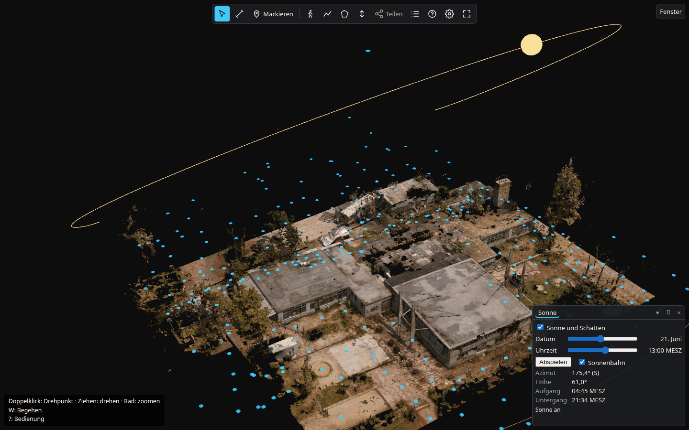
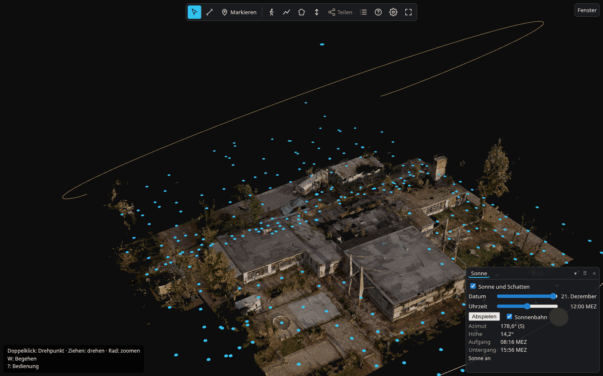
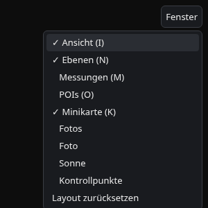
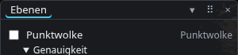
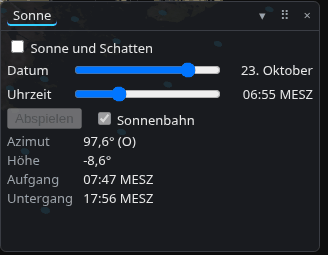
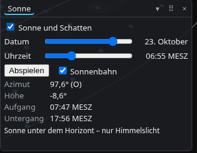
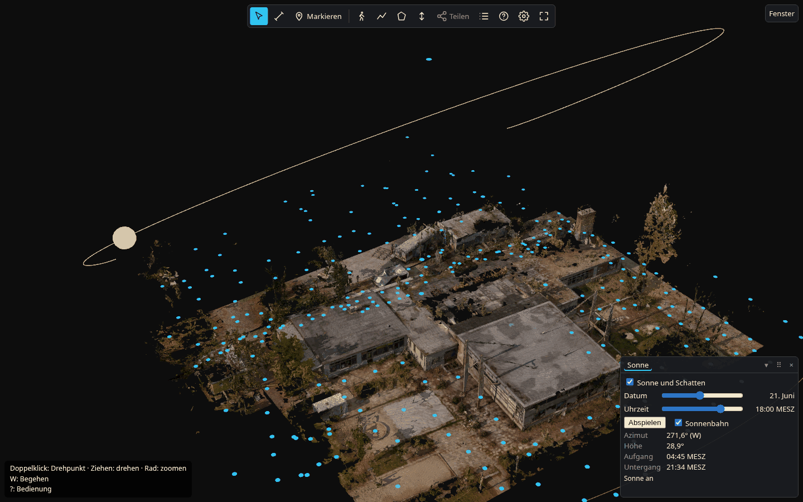
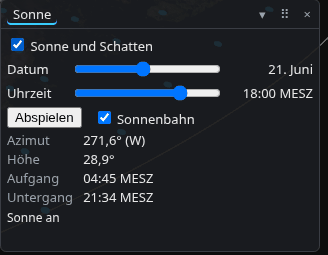

# Sonne und Schatten

Das Sonnenmodul zeigt, wo zu einem gewählten Datum und einer Uhrzeit Sonne und Schatten liegen. Damit beantwortest du
Fragen wie: Wann liegt die Terrasse im Schatten? Wie viel Sonne bekommt ein Beet? Lohnt sich eine Solaranlage auf
diesem Dach?

Es gibt zwei Teile:

- **Im Viewer:** Das Fenster „Sonne“ zeigt Licht und Schatten live auf dem 3D-Modell. Du bedienst es mit der Maus.
- **Als PDF-Bericht:** Der Sonnenbericht rechnet ein ganzes Jahr durch und nennt Zahlen (Sonnenstunden, Stromertrag).
  Ihn erzeugt der Betreiber per Befehl. Im Viewer gibt es dafür keinen Knopf.

## Was ist Verschattung?

Die Sonne steht nicht immer gleich. Über den Tag wandert sie von Osten über Süden nach Westen. Übers Jahr steht sie im
Sommer hoch am Himmel und im Winter flach. Hohe Sonne wirft kurze Schatten, flache Sonne wirft lange.

Alles, was im Weg steht, wirft einen Schatten: Gebäude, Mauern, Bäume. **Verschattung** heißt: Man schaut, welche
Stellen zu einer bestimmten Zeit im Schatten liegen und welche Sonne bekommen.

Das Modul stellt dafür Datum und Uhrzeit ein und zeichnet den Schatten, den es dann gäbe. Du siehst denselben Blick im
Juni mittags und im Dezember mittags:

*21. Juni, 13:00 Uhr. Die Sonne steht hoch. Der gelbe Punkt ist die Sonne, der Bogen ist ihre Bahn an diesem Tag.*

*21. Dezember, 12:00 Uhr. Die Sonne steht flach, die Schatten sind länger und das Bild ist dunkler.*

## In 1 Minute

Voraussetzung: Das Projekt enthält ein **Mesh** (ein Oberflächenmodell aus Dreiecken, nicht nur Punkte) und hat einen
bekannten Ort (siehe [Geht nicht?](#geht-nicht)). Sonst fehlt der Eintrag „Sonne“.

1. **Fenster „Sonne“ öffnen.** Oben rechts auf „Fenster“ klicken, dann auf „Sonne“.

   

2. **Punktwolke ausblenden.** Im Fenster „Ebenen“ das Häkchen bei „Punktwolke“ entfernen. Schatten fallen nur auf das
   Mesh. Die Punktwolke liegt sonst darüber und verdeckt es.

   

3. **„Sonne und Schatten“ anhaken.** Anfangs ist das Häkchen aus, und das Fenster zeigt nur die Werte.

   

4. **Datum und Uhrzeit einstellen.** Beim Einschalten steht die Uhr auf der aktuellen Zeit. Ist es dunkel, steht dort
   „Sonne unter dem Horizont, nur Himmelslicht“. Dann gibt es kein Sonnenlicht und keine Schatten. Zieh den Regler
   „Uhrzeit“ in die Tagesmitte.

   

5. **Schatten ansehen.** Dreh und zoom die Ansicht wie gewohnt. Zieh die Regler und schau, wie die Schatten wandern.
   „Abspielen“ lässt einen Tag im Zeitraffer ablaufen (eine Stunde je Sekunde).

   

   *21. Juni abends: Die Sonne steht tief. Die Schatten werden lang.*

6. **Beenden.** „Sonne und Schatten“ abhaken. Dann gilt wieder die normale Beleuchtung.

## Die Bedienelemente

| Element | Was passiert | Wann brauchst du es |
|---|---|---|
| **Sonne und Schatten** (Häkchen) | Schaltet Sonnenlicht und Schatten ein oder aus. Alles andere im Fenster wirkt erst, wenn es an ist. | Immer zuerst. |
| **Datum** (Regler) | Wählt den Tag im Jahr. Rechts steht das Datum, zum Beispiel „21. Juni“. | Für den Vergleich der Jahreszeiten: hohe Sonne im Sommer, tiefe im Winter. |
| **Uhrzeit** (Regler) | Wählt die Uhrzeit in 5-Minuten-Schritten. Rechts steht sie mit MEZ (Winterzeit) oder MESZ (Sommerzeit). | Um zu sehen, wann eine Stelle in den Schatten kommt oder daraus heraus. |
| **Abspielen** / **Anhalten** | Lässt die Zeit laufen: eine Stunde je Sekunde. Es läuft nur der helle Tag, nach dem Untergang beginnt wieder der Aufgang desselben Tages. | Wenn du den Schattenverlauf über den Tag sehen willst. Der Knopf ist grau, solange die Sonne aus ist. |
| **Sonnenbahn** (Häkchen) | Zeigt den Weg der Sonne als gelben Bogen und die Sonne als gelben Punkt. Zwei blasse Bögen zeigen den längsten Tag (21. Juni) und den kürzesten (21. Dezember). | Um zu verstehen, woher das Licht kommt. Ausschalten, wenn der Bogen stört. |
| **Azimut** | Himmelsrichtung der Sonne in Grad: 0° ist Norden, 90° Osten, 180° Süden, 270° Westen. In Klammern steht die Richtung als Buchstabe, zum Beispiel (S). | Wenn du wissen willst, aus welcher Richtung das Licht kommt. |
| **Höhe** | Winkel der Sonne über dem Horizont. 0° ist Horizont, 90° wäre senkrecht über dir. Unter 0° ist die Sonne untergegangen. | Hohe Werte bedeuten kurze Schatten, niedrige lange. |
| **Aufgang / Untergang** | Uhrzeit von Sonnenaufgang und Sonnenuntergang am gewählten Tag. | Um die Uhrzeit sinnvoll zu wählen. |

Die Zeitzone ist fest auf Deutschland (Europa/Berlin) eingestellt. Unter den Werten steht der Ort, aus dem das Modul den
Sonnenstand rechnet. Er stammt aus dem Koordinatensystem des Projekts.

Für das Fenster „Sonne“ gibt es keine eigene Taste und keine eigene Controller-Belegung. Die Regler erreichst du mit
der Tabulatortaste, die Pfeiltasten verstellen sie. Screenreader lesen Datum und Uhrzeit vor.

## Der Sonnenbericht (PDF)

Der Viewer zeigt die Sonne zu **einem** Zeitpunkt. Der Sonnenbericht fasst das **ganze Jahr** zusammen und schreibt
Zahlen auf. Ihn erzeugt der Betreiber der Installation mit dem Befehl `scanview-sonne` (Beschreibung in der
[Import-Anleitung](../../import/README.md), Abschnitt „Sonne“). Du brauchst dafür eine markierte Fläche aus dem Viewer
(Flächenmessung). Fordere den Bericht beim Betreiber an und nenne die Fläche. Es gibt zwei Arten.

### Bericht für ein Dach oder eine andere Fläche (Verschattung und Ertrag)

Für die Frage: Lohnt sich eine Solaranlage hier? Der Bericht nimmt die Fläche, legt viele Messpunkte darauf und prüft für
jeden Punkt und jede Sonnenstellung des Jahres, ob etwas im Weg steht. Dazu kommen Wetterdaten aus dem
EU-Strahlungsdienst PVGIS (ein öffentlicher Dienst der EU-Kommission). Darin stehen:

- **Ertrag je Jahr** in Kilowattstunden (kWh) für eine angegebene Anlage, im Mittel.
- **Schwaches Jahr (P90):** Das ist ein Wert, den der Ertrag in 9 von 10 Jahren mindestens erreicht hat. **P50** ist
  der mittlere Wert.
- **Verlust durch Verschattung:** Wie viel Ertrag die Schatten kosten.
- **Wärmekarte:** Jeder Punkt der Fläche ist eingefärbt. Dunkel heißt weniger Sonne.
- **Sonnenstunden je Monat** und die Vergleichswerte ohne Verschattung.

### Gartenbericht (Sonnenstunden und Lichtlage)

Für die Frage: Wie viel Sonne bekommt ein Beet? Der Bericht zählt für jeden Bodenpunkt die **direkten Sonnenstunden**
je Tag und ordnet ihn einer **Lichtlage** zu, nach den Gärtnerregeln der britischen Gartengesellschaft RHS. Gemeint ist
die Sonne im Juni und Juli:

| Lichtlage | Direkte Sonne je Tag |
|---|---|
| sonnig | mehr als 6 Stunden |
| halbschattig | 3 bis 6 Stunden |
| mäßig schattig | 2 bis 3 Stunden |
| schattig | weniger als 2 Stunden |

Das sind keine amtlichen Grenzen. Liegt ein Punkt nahe an einer Grenze (0,4 Stunden Abstand oder weniger), gilt er als
**unsicher**. Er ist im Bericht aufgehellt. Eine Pflanzenliste enthält der Bericht noch nicht.

### Warum stehen dort Spannen?

Bäume sind in einem 3D-Modell aus Fotos oft löchrig. Durch die Löcher fällt auf dem Papier Sonne, die in echt von den
Blättern geschluckt wird. Der Gartenbericht rechnet deshalb zweimal:

1. mit dem Modell, wie es ist (zu viel Sonne, weil die Kronen Löcher haben),
2. mit geschlossenen Baumkronen (eher zu wenig Sonne).

Die Wahrheit liegt dazwischen. Darum steht jede Zahl als Spanne da. **So liest du es:** Nimm die untere Zahl als
vorsichtige Schätzung. Ist die Spanne breit, hängt das Ergebnis stark von den Bäumen ab. Steht ein Punkt als „unsicher“
da, frag vor Ort nach oder schau selbst hin.

Beide Berichte sind „Schätzung, keine zugesicherte Eigenschaft“ und nennen im Fachteil, was sie nicht können.

## Geht nicht?

| Problem | Ursache und Lösung |
|---|---|
| Im Menü „Fenster“ fehlt der Eintrag „Sonne“. | Das Projekt hat kein Mesh. Das Modul zeichnet Schatten nur auf Meshes. Der Betreiber muss ein Mesh ergänzen. |
| Im Fenster steht „Sonne nicht verfügbar“ und die Bedienelemente sind gesperrt. | Das Projekt hat lokale Koordinaten und keinen Ort. Das Modul rät den Ort nicht. Der Betreiber muss das Projekt georeferenzieren (mit einem Koordinatensystem versehen). |
| Ich sehe keine Schatten. | Prüfe der Reihe nach: Ist „Sonne und Schatten“ angehakt? Steht unter dem Horizont-Hinweis „Sonne unter dem Horizont“? Dann Uhrzeit in die Tagesmitte ziehen. Ist die Punktwolke noch an? Dann ausblenden. Ist das Mesh in „Ebenen“ sichtbar? |
| Die Sonne scheint von der falschen Seite. | Der Ort kommt aus dem Koordinatensystem des Projekts. Stimmt es nicht, ist der Sonnenstand falsch. Melde das dem Betreiber. Prüfe auch Datum und Uhrzeit (Sommerzeit!). |
| Es ist dunkel, obwohl es Mittag ist. | Im Winter bei flacher Sonne ist das Bild dunkler. Das ist richtig. Prüfe sonst das Datum. |
| Abspielen und Sonnenbahn sind grau. | Die Sonne ist ausgeschaltet. Erst „Sonne und Schatten“ anhaken. |
| Auf manchen Geräten ruckelt es. | Schatten kosten Grafikleistung. Schalte die Sonne aus, wenn du sie nicht brauchst. Der Schatten braucht bis zu 128 MiB Grafikspeicher, der beim Ausschalten wieder frei wird. |

## Was das Modul nicht kann

- **Schatten entstehen nur von dem, was im Modell steckt.** Wurden beim Aufbereiten Bäume oder Teile der Umgebung
  weggeschnitten, fehlen auch deren Schatten. Dasselbe gilt für Nachbarhäuser oder Bäume außerhalb des aufgenommenen
  Bereichs. Im Viewer fehlen sie ganz. Die Berichte berücksichtigen von außerhalb nur den Geländehorizont (Hügel, aus
  einem groben Höhenmodell).
- **Punktwolken und Sichtschichten werfen keine Schatten.** Nur Meshes tun das.
- **Kein Wetter.** Gezeigt wird, wo die Sonne hinkommt, wenn sie scheint, nicht wie oft sie scheint. Die Wirklichkeit
  ist durch Wolken deutlich weniger. Der Ertragsbericht nutzt Wetterstatistik, aber nur für den Strom.
- **Die Laubzeit steckt im Modell.** Wurde im belaubten Zustand aufgenommen, ist es im Winter in Wirklichkeit heller als
  berechnet. Bei kahler Aufnahme ist es im Sommer dunkler.
- **Baumkronen sind lückenhaft** (siehe oben). Echte Kronen lassen etwas Licht durch, aber nie ganz so viel wie ein
  Modell mit Löchern.
- **Schattenkanten sind nicht auf den Zentimeter genau.** Die Kanten hängen von der Auflösung des Schattenbilds ab.
  Dünne Dinge wie Masten oder Äste können eine Viertelstunde zu viel oder zu wenig Schatten zeigen. Der Sonnenstand
  selbst ist nach einem anerkannten Verfahren gerechnet (NOAA, gegen die Referenz NREL SPA geprüft).
- **Dinge, die nur zeitweise da sind**, etwa geparkte Fahrzeuge oder Möbel, stehen im Modell und werfen Schatten.
- **Die Zeitzone ist fest** auf Deutschland.
- **Kein Ersatz** für eine Garten-, Dach- oder Anlagenplanung vor Ort. Boden, Feuchte, Statik und Netzanschluss
  kommen im Bericht nicht vor.
